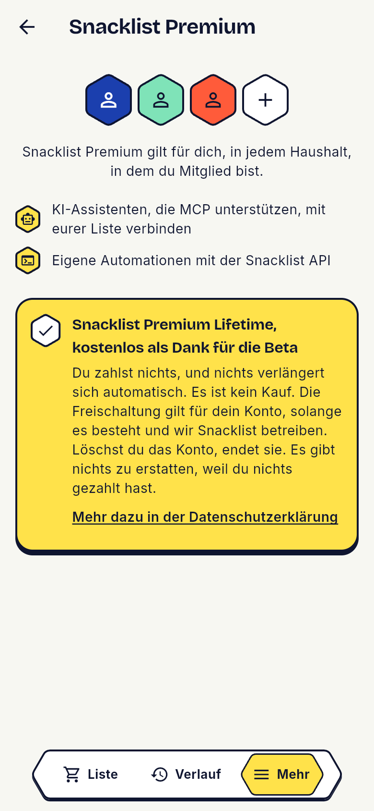
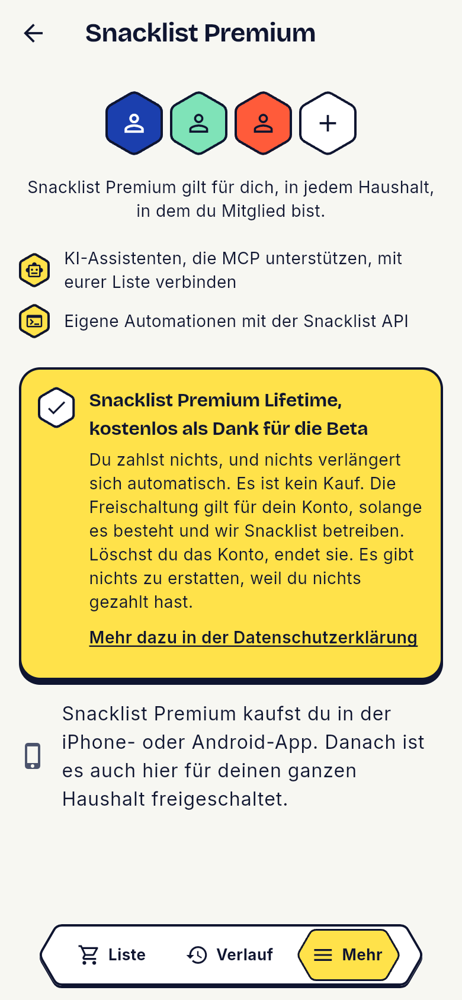
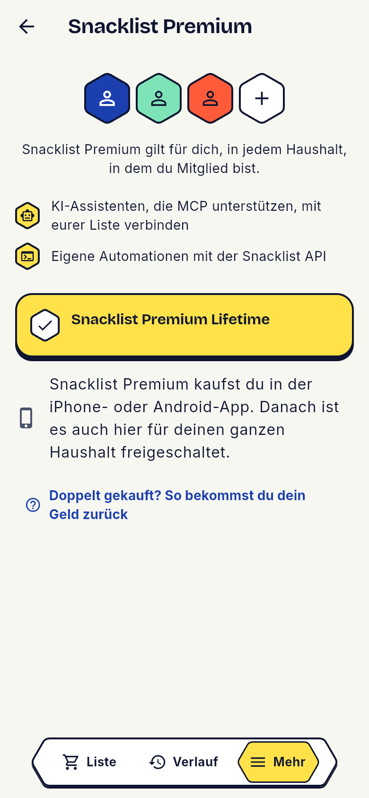

# Job 371b: Legal follow-ups on #631

Legal Review 22 Nov 2026 on #631: conditional GO for the plumbing, HOLD on `--apply` and on the
new strings. This job applies N-343, N-345, N-346 and N-347 on the same PR. It does not merge,
and `--apply` was not run.

## What changed

- **N-343.** `premiumBetaLifetimeBody` is Legal's text, DE and EN: not a purchase, applies while
  the account exists and Snacklist runs, ends with the account, nothing to refund.
- **N-345.** `premiumHeroBody` says Premium applies to the person in every household they are a
  member of, instead of the whole household.
- **N-346.** The refund link („Doppelt gekauft? So bekommst du dein Geld zurück“) shows only to
  someone who paid once sales are on, or after buying Lifetime twice. `Unlocks.purchased` /
  `Entitlements.purchased` say whether a store purchase row is there; `premium_screen.dart`
  `paid` adds a purchase that is unlocking or belongs elsewhere.
- **N-347.** `scripts/iap/beta-lifetime.ts --apply` throws without `--created-before`.
  `docs/PAYWALL_RELEASE.md` 5.3a and 6.2, `docs/PURCHASES.md` and the script header agree: the
  public-launch cut-off T is fixed in advance, 5.4 runs at T, and every `--apply` (the first one
  shortly before T, the same command right after 5.4) passes exactly T (review 0).

## How to verify

- `cd app && flutter test test/purchases test/design` (with the CI Flutter, 3.50.0). The group
  "Legal Review N-69, N-346: the refund link" has fictional users: a beta account's own grant, a
  tester household, a beta household with an end, someone who bought nothing (all hidden with
  sales on), a household that paid, a user who pays yearly, a beta account that also paid (shown).
  With the old rule (`launched || boughtLifetimeTwice`) four of them fail.
- `deno test --allow-env --allow-net --allow-read scripts/iap/beta-lifetime_test.ts`: `--apply`
  alone throws.
- The premium goldens show the new hero and body.
- Real app: `journeys/premium-beta-lifetime.mjs` (verify-snacklist) now also switches
  `premium_offer` on. Run on this branch's web build, 22 Nov 2026: Mia's page shows the new hero
  and body and no refund link (grant only); with a store purchase row next to the grant the link
  appears (632 ms). Screenshots and log: `docs/screenshots/371b/`.

| Grant, sales off | Grant, sales on: no refund link | Grant and a purchase: refund link |
| --- | --- | --- |
|  |  |  |

## Left for Legal (not in this job)

The web note `premiumWeb` („… Danach ist es auch hier für deinen ganzen Haushalt
freigeschaltet.“), the slogan „Einer kauft. Alle haben es.“ and the plan note („Premium gehört
dann zum Haushalt …“) still speak of the household next to the new per-account hero. They are
N-308 leftovers like `invitePremiumShared`; the brief kept them out of this job.

## Review 0 fixes

- **N-347 runbook made consistent (must fix).** The first draft's first `--apply` passed the moment
  of the run, not the public-launch cut-off, while the script header, PURCHASES.md and NEEDS_LEAD
  said otherwise. Now T, the moment the sale opens, is fixed before the launch day; 5.4 runs at
  T, never before; every grant run (shortly before T, and the same command right after 5.4)
  passes exactly T. No gap in which beta accounts lack the grant while the sale is open, and no
  run with any other value. Docs, the script comment and DECISIONS 371b.3 only; ARB files
  unchanged, so the hashes stay valid.
- FEATURES-FOR-WRITERS: the refund link shows to people whose account or household has a purchase.
- The journey also asserts the N-345 hero and no refund link with sales off; rerun on this branch's
  web build, 22 Nov 2026 14:59 UTC: PASSED (`docs/screenshots/371b/journey.log`).
- NEEDS_LEAD now asks Legal explicitly about members of a household where someone else bought.
