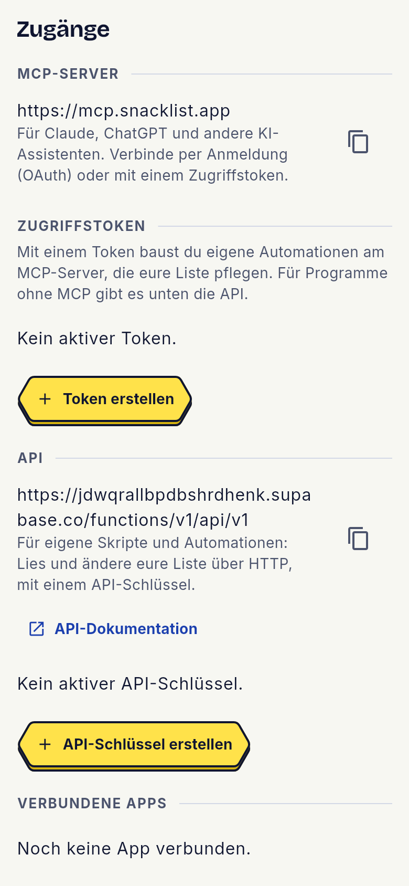
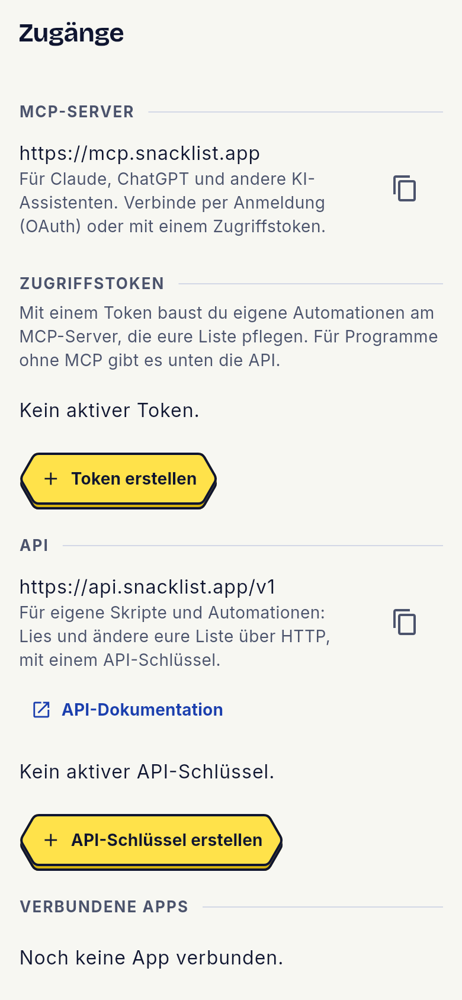

# Job 398: api.snacklist.app/v1 through Vercel (AD2)

**What.** The Vercel project `hummlist-mcp` (`mcp-proxy/`) also serves the public REST API at
`https://api.snacklist.app/v1`: one host rule, first in `mcp-proxy/vercel.json`, forwards every
path to `…/functions/v1/api/<path>?via=api-snacklist`. The supabase.co URL keeps working
unchanged. MCP stays on `mcp.snacklist.app`.

**API fix.** Behind Vercel, `X-Real-IP` is Vercel's address, so the "unknown keys per address"
guard would have put every proxied caller in one bucket. Requests with the `api-snacklist`
marker now use `x-vercel-forwarded-for` (`supabase/functions/api/handler.ts`, `ipHash`), and the
marker is dropped before the strict query check (`queryOf`).

**App.** Behind the PostHog flag `api-snacklist-app` (rollout off, `releases/flags.json`),
Mehr › Zugänge shows and copies `https://api.snacklist.app/v1` instead of the function URL.
Flag off: unchanged. No ARB, privacy or API docs text changed.

**Verified.**
- `scripts/mcp-proxy-routes_test.ts`: 62 pass (api host first, MCP hosts unchanged, no-cache on
  every host); moving the api rule last fails 11.
- `supabase/functions/api/` with `FG_DB_TEST=1` on the local stack: 66 pass, including a new
  integration test (two callers behind one Vercel address get separate budgets; a proxied
  `?limit=1&via=api-snacklist` answers 200). Making `ipHash` ignore the proxy fails it.
- HTTP through the local Kong and edge runtime: proxied, one client counts 19→18 and a second
  client starts at 19; direct, a forged `x-vercel-forwarded-for` changes nothing.
- `scripts/api-proxy-smoke.sh` against the local function: 3 pass, keyed checks skipped.
- `flutter test test/settings/access_screen_test.dart`: 31 pass (new: flag on shows and copies
  the new URL).

**Left for the lead.** Attach the domain `api.snacklist.app` to Vercel project `hummlist-mcp`,
then run `API_SMOKE_KEY=fgp_… scripts/api-proxy-smoke.sh` (proves that the marker and the caller's
query both arrive; separate budgets per caller stay proven only by the tests). Turn the flag on only after the privacy text names the host.

Merged as: next commit on main.
