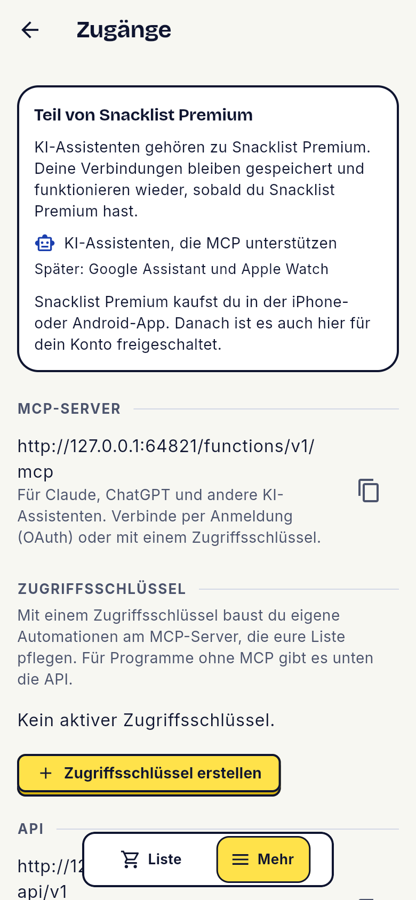
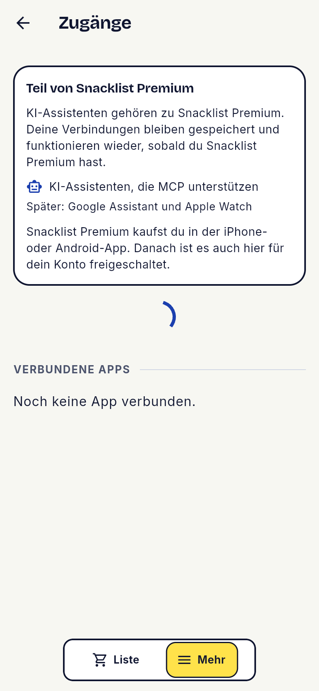
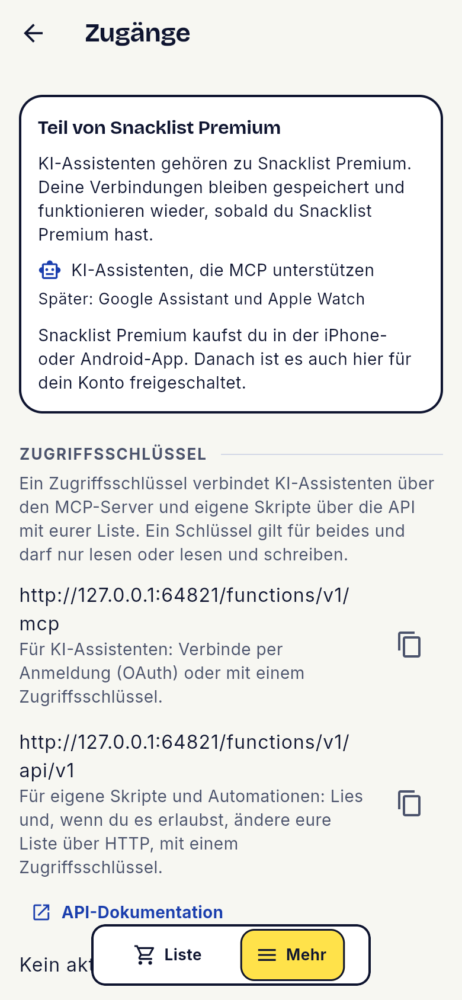

# Job 447: Zugänge no longer flashes the old sections

**Bug (vmaint-20261125).** Opening Mehr › Zugänge drew the old sections („MCP-Server“, „Zugriffsschlüssel“ with „Zugriffsschlüssel erstellen“, „API“) until the `unified_keys` RPC answered, then the one list of keys. `AccessState.unified` started as `false`.

**Fix.** `app/lib/settings/access_cubit.dart`: `unified` is `bool?`, null until read, and the cubit emits the answer whether true or false. `app/lib/settings/access_screen.dart`: with the `unified-keys` flag on and the switch unread, one spinner where the keys go, then the layout the switch names. Flag off: the old sections at once, no wait. Why not default to `true`: docs/DECISIONS.md, "Job 447".

**Tests.** `app/test/settings/access_screen_test.dart`, group "job 397": "flag on: no layout flashes before the server switch is read, then one section", "... then two sections when it is off" (both fail on main's code: `Found 1 widget with text "MCP-SERVER"`), and "flag off: two sections at once, without waiting for the server switch". `flutter test test/settings/` on Flutter 3.50.0: 197 passed.

**Drive.** verify-snacklist users' build on a local stack (port block 648xx), German, with `/rest/v1/rpc/unified_keys` held 3 s by Playwright:

| | while the switch is unread | after |
| --- | --- | --- |
| main |  (old sections 194 ms after the tap) | the one list |
| this branch |  |  |

Feature map: `.cursor/skills/verify-snacklist/features/ai-assistants.md`, `ai-unified-keys`, no longer says the token sections show for a moment. FEATURES-FOR-WRITERS never mentioned the flash; unchanged.

**Ships** with the next green main build to TestFlight and Play internal. No flag change needed: `unified-keys` is full and the server switch is on in production.
