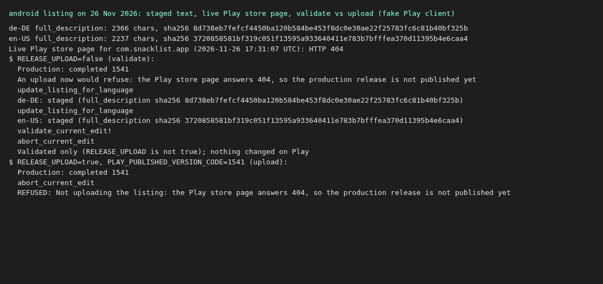
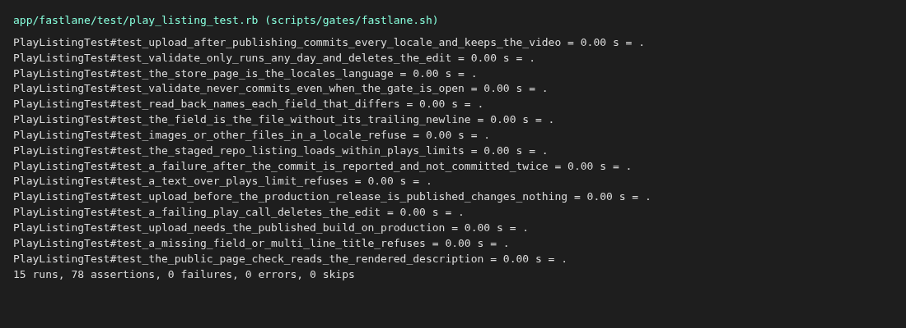
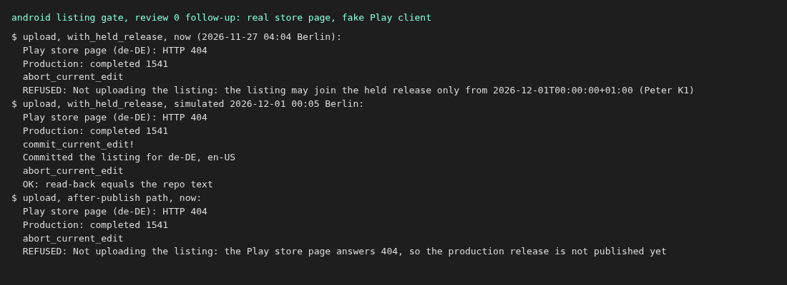

# Job 480: the staged Play listing goes up right after the Dec 1 production publish

Peter K1 (26 Nov 17:03) and Legal LK1: the live Play de-DE full description still opens with „Kostenlos, ohne Werbung, für den ganzen Haushalt.“. It must be replaced by the staged repo listing before Premium is sold, and no listing edit may happen before the Dec 1 production publish of build 1541.

## What was built

- `app/fastlane/play_listing.rb` holds the listing logic. It loads `metadata/android/<locale>/{title,short_description,full_description}.txt`, minus the trailing newline, and refuses texts over Play's limits (30/80/4000) or any extra file such as images or `video.txt`. It also holds the publish gate, the edit sequence, the API read-back and the public store page check.
- `app/fastlane/Fastfile` gets two lanes:
  - `android listing` validates any day. With `RELEASE_UPLOAD=true` it commits only when play.google.com serves the app (today: 404) and production carries `PLAY_PUBLISHED_VERSION_CODE` as `completed`. It then reads every field back and fails on any sha256 difference.
  - `android listing_check` is read only. It compares the API listing and the public store pages.
- `.github/workflows/play-listing.yml` is a dispatch workflow with modes `validate` (default), `upload` and `check`, in the `release` environment.
- `docs/RELEASE.md` gains the "Store listing upload" section, the lanes table rows and the 1 Dec 2026 update. Its Store release checklist now requires the upload with read-back, then the publish of the listing change and a passing `check`, and only then the Premium purchase screen.
- `docs/CI.md` and `scripts/gates/fastlane.sh`: the `fastlane` CI job now runs `app/fastlane/test/play_listing_test.rb` (15 tests).
- `docs/DECISIONS.md` and `docs/NEEDS_PETER.md` have sections for job 480.

No listing text was edited and no Play edit was opened or committed.

## Verification

- `bundle exec ruby fastlane/test/play_listing_test.rb`: 15 runs, 78 assertions, 0 failures (ruby 3.3, the lockfile's gems). `fastlane lanes` lists both lanes. `scripts/lint.sh` passes, which includes `check.mjs`, the limits and Legal's word rules. actionlint and shellcheck are clean.
- Mutation check: with the gate's `raise` removed, 2 of the 15 tests fail.
- Real gate input on 26 Nov 2026 17:31 UTC: the store page for `com.snacklist.app` answers 404, so an upload refuses and a validate goes through (screenshot `gate.png`, fake Play client).
- The public page parser read Google Keep's real de page (1,891 characters, 16 lines).
- Staged de-DE `full_description` sha256 (Legal's `printf '%s'` convention): `8d738eb7fefcf4450ba120b584be453f8dc0e30ae22f25783fc6c81b40bf325b`. en-US: `3720858581bf319c051f13595a933640411e783b7bfffea370d11395b4e6caa4`.

## Not verified here

- No real Play validate run. It needs the `release` environment from `main`. After merge, `gh workflow run play-listing.yml` (validate) is safe any day, and it is the first real check of the edit against Play.
- The public page comparison of our own listing could not run, because the page is 404 until Dec 1.

## Dec 1 order (Ops)

See `docs/NEEDS_PETER.md` "Job 480":
1. Publish 1541.
2. Run `mode=upload published_version_code=1541`.
3. Publish the listing change after Google approves it, then run `mode=check`.
4. Only then switch on the Premium purchase screen.

## Review 0 follow-up

Fixed in a follow-up PR (the first one had merged before the review):

- **Must-fix 1.** `docs/PAYWALL_RELEASE.md` 5.4 now has a hard Legal LK1 precondition: a successful upload, the listing change published, and `mode=check` passed. 5.3a says T comes after that.
- **Must-fix 2.** New `with_held_release` upload path (lane env `PLAY_LISTING_WITH_HELD_RELEASE`), refused before 2026-12-01 00:00 Berlin. It lets the listing join 1541 under managed publishing, so one publish releases both. NEEDS_PETER "Job 480" now states the decision, the default (publish 1541 on time; the sale waits for `check` if the review is late) and Peter's alternatives.
- **Nice-to-haves.**
  - The lane body moved into the tested `PlayListing.run`.
  - The public page is compared exactly, with both sha256s logged.
  - The LISTING.md release-order line is updated.
  - The store page's HTTP answer is logged, and the US-runner case is documented.
  - The overlap with release.yml is documented instead of a shared concurrency group, because a group would cancel queued Release uploads.

Tests: 20 runs, 113 assertions, 0 failures. Four new mutations are caught: held-path date gate off, read-back skipped, exact page compare off, store-page gate off.

