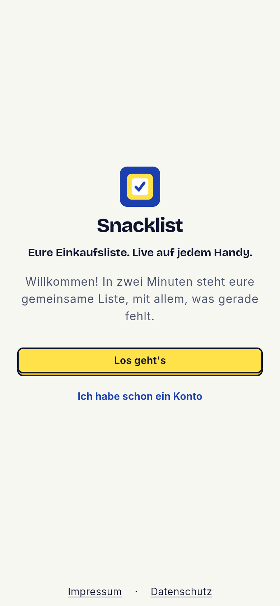
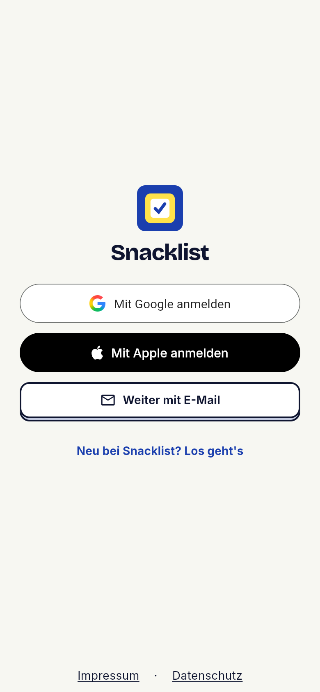

# Job 486: a sign-out opens the start screen, one sign-in page

Peter (27 Nov 2026): after a sign-out he landed on a sign-in page with no way to say he is new,
while a cold start shows the start screen and a sign-in with „Neu bei Snacklist? Los geht's“.
He wants a sign-out to open the start screen („Los geht's“ / „Ich habe schon ein Konto“).

## What changed

- `app/lib/shell/router.dart`: `authRedirect` sends a sign-out to `/start` (not `/login`); an
  invite or an account deletion keeps the sign-in. A signed-out `/start?next=` and the guided start's
  steps keep a link. `RedirectMemory` no longer reads the sign-out's own location as a link when the
  redirect runs again there. `goToSignIn` and `goToStart` keep the location's `next`.
- `app/lib/onboarding/draft.dart`, `onboarding_cubit.dart`: a sign-out parks an unfinished guided
  start (`parked`, saved with the draft), so the start screen shows; „Los geht's“ or the next sign-in
  takes it up again. A start signed out still resumes a draft at once.
- `app/lib/onboarding/steps.dart`: the account step's web return address keeps the link.
  After an account deletion, „Neu bei Snacklist?“ opens the start screen instead of bouncing back.
- `app/lib/session/login_screen.dart`: „Neu bei Snacklist? Los geht's“ shows on every sign-in but an
  invite's (it was hidden for a `next` link too).
- Tests: `router_test.dart` (sign-out to `/start`, invite and deletion exceptions, the link through
  the guided start, the second read at the sign-out location: fails without the fix),
  `your_name_gate_test.dart` (the real router: sign-out from More and from the name step lands on the
  start screen with both buttons and the Impressum and Datenschutz links, `canPop` false),
  `login_screen_test.dart` (the button with and without a link opens `/start` keeping the link, not
  for an invite; legal links shown). e2e: `expectSignedOutStart` and `haveAccount` helpers, seven
  specs moved from `/login` to `/start` after „Abmelden“.
- verify-family-groceries: `fg logout` waits for the start screen, then taps „Ich habe schon ein
  Konto“ (it still ends on the login screen); recipes updated.
- verify-snacklist: `journeys/sign-in.mjs`, `journeys/display-name.mjs` (waits for `/start`),
  `features/app-links.md`, `more-help.md`, `display-name.md`, `theme.md`, `features/sign-in.md`, `features/onboarding.md`,
  `FEATURES-FOR-WRITERS.md` (Sign-up and sign-in).

## Evidence

Release web build, local stack, `drive.sh sign-in` PASS in German and English.

| Before (main 6fb941fa4) | After: sign-out | After: „Ich habe schon ein Konto“ | After: a link signed out |
| --- | --- | --- | --- |
|  |  |  |  |

The localStorage keys a sign-out removes are the same five on main and on this branch
(`analytics.tester_groups`, `household.<id>`, `listprefs.<id>.<list>`, `sb-127-auth-token`,
`seen.<id>.<list>`).

## Not verified

The iOS app (no simulator on hz) and the native Linux build (no CMake on hz). Peter's screenshot 2
did not reproduce on the web build of main: there the button showed after a sign-out. The memory
fix targets the one path found that hides it (a second redirect at the sign-out location); that it
was Peter's path is inferred.
