# Job 487: FH1, the focus ring inside the control (2026-11-27, Europe/Berlin)

Peter picked FH1 („inset ring“) from prototype round FH (job 485, draft PR #781, head 921c7210). This job
ships it in the Flutter app (iOS, Android, web) as a fix: no flag, no layout change, no ARB or legal text.

## What users see

- The focused control's contour turns the focus colour and a 3 px ring grows inward from it. Nothing is
  drawn past the control, so every gap stays as it is unfocused. Before, a text field and the buttons drew
  a 3 px ring 2 px outside (5 px past the control: the own-store field overlapped its check button), and
  chips, text buttons, icon buttons, list rows, the add sheet's suggestion rows and Läden's rows showed a
  10–12 % fill that fails WCAG 2.4.13 (3:1).
- Covered: buttons, text and icon buttons, text fields, chips, the store and category options, list rows,
  the add sheet's rows, Läden's rows, check box, switch, radio, segments, the tabs, the chain suggestion
  cards, Premium's plan cards, the feedback note cards, the Verlauf rows and day cells, the report page's
  privacy link.
- Not covered yet: `ListTile` rows (More, Einstellungen, household pages, dialog lists) keep Material's
  grey focus fill, and the add field on the list has no indicator (see "Not done").
- Cobalt (`accent`) on ordinary faces, navy (`onHoney`) on a honey face (picked chip and option, „Weiter“
  and the other main buttons, the selected tab and segment, the trip strip's end button, the picked Premium
  plan and its honey card's link), in both themes. The add sheet's „Wie getippt“ row is honey-soft, not
  honey: cobalt there (7.8:1 light, 6.4:1 dark). The trip strip's pause button sits on the inverse strip,
  where cobalt would not stand out: its ring takes the strip's light ink.
- When the ring shows did not change: a text field keeps it after a tap (it marks where typing goes);
  buttons, chips, options, text buttons, rows and tabs show it for focus as before (the InkWell-based ones
  for keyboard focus only, as Material's fill did). A focused button that is also hovered or pressed keeps
  its hover or press ink.
- One ring at a time: a row or card shows its ring only while it has the focus itself, not while a
  control inside it does. On Läden, Tab from „Supermarkt“ to its delete button moves the ring to the
  button; the row's ring goes (review 1: before, both stayed on).

Screenshots (left main `b12a435ad`, right this branch; release web build, 390×844, keyboard Tab):

| | |
| --- | --- |
| Own-store field, light / dark | 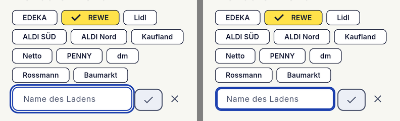 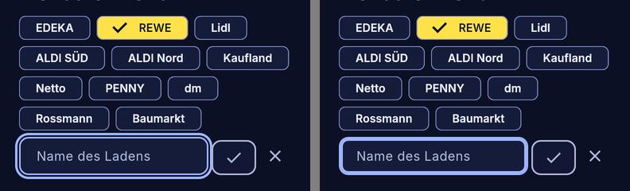 |
| Picked chip REWE, light / dark | 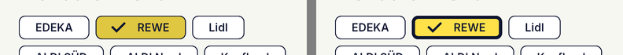 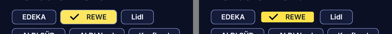 |
| „Weiter“, light / dark | 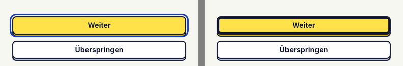 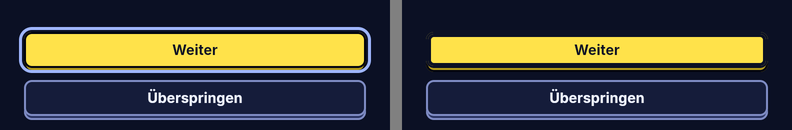 |
| List row, light / dark | 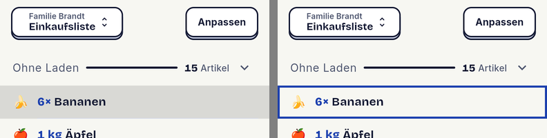 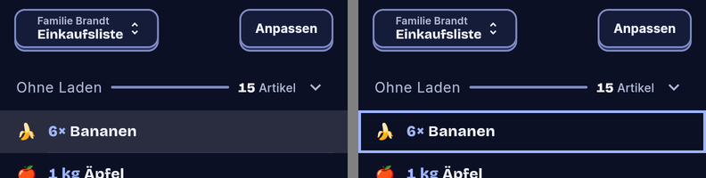 |
| Back arrow (icon button), light / dark |   |
| Läden's row | 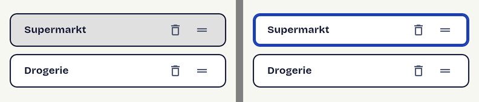 |
| Läden: the delete button focused, the row not (this branch) | 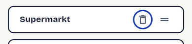 |
| Segment „System“, light / dark | 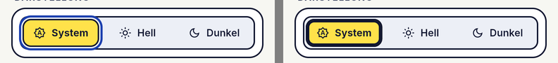 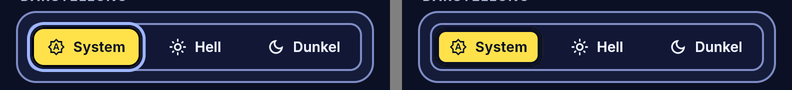 |
| Selected tab | 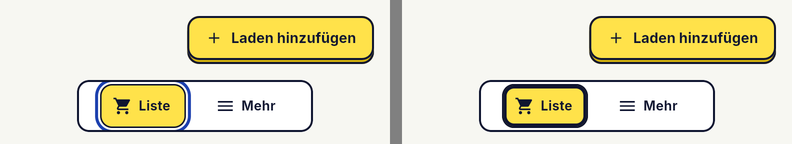 |
| Add sheet row „Joghurt“ (this branch only), light / dark | 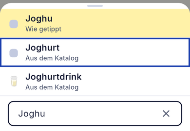 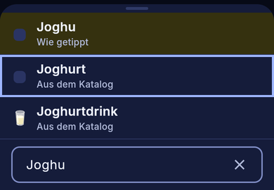 |

In dark mode a navy ring on a honey face next to the navy page reads as the honey face getting smaller
(„Weiter“, the picked chip, „System“). That is FH-Q4's one rule (navy on honey in both themes).

## Where

- `design/tokens/snacklist.tokens.json`, `build.mjs`: `HlFocus` in Dart is only `ringWidth` (3); `ringGap`
  is gone from the app. The token `focus.ring.gap` stays for the web pages' CSS outline offset (site, join
  page, nexus, MCP page), whose output did not change.
- `app/lib/design/focus_ring.dart`: `focusRingColor`, `paintFocusRing` (the ring at
  `outline(-(contour + 1.5))`, 3 px wide), `showsFocusRing` (InkWell's rule: focused and the keyboard
  highlight mode), `withFocusRing` (a `ButtonStyle` with the ring as its focused side over the button's own
  contour, no focus-only overlay; unfocused the shape keeps its own side), `HexFocusRingPainter` (tabs and
  segments), `RingHexBorder` (a chip's border room stops at its 1 px contour, so the 4 px focused side
  paints inward without moving the label), `FocusRingChip` (a chip's InkWell reads `ThemeData.focusColor`;
  set transparent per chip, not app-wide, which would take the only focus mark from every `ListTile`),
  `FocusRingInkWell` (InkWell rows and cards; no extra `Focus` widget, so no new semantics node on web;
  an optional colour for honey faces) and `outerRingReach` (the 5 px the old ring took, kept where layout
  or a clip counted on it).
- Painters moved inside: `tactile.dart`, `field_border.dart` (`ContourInputBorder`, `fieldTheme`),
  `hex_checkbox.dart`, `hex_switch.dart`, `hex_radio.dart`, `hex_segmented.dart`, `list/list_tabs.dart`,
  `shell/shell.dart`.
- Fills replaced: the chip theme and six chip call sites; the text button theme, seven text buttons with
  their own colour and `OptionChip` (`withFocusRing`); the icon button theme (`iconButtonTheme`), the trip
  strip's pause button and the dictation button; `FocusRingInkWell` in `HexPill`, `item_row.dart`, the add
  sheet's two row kinds, `chain_suggestions.dart` (its contour turns cobalt too), `premium_screen.dart`'s
  plan card and `feedback_hub.dart`'s note card (both inside an `HlSticker`, `HlSticker.innerOutline`),
  `history_screen.dart`'s two row kinds and day cell, `report_page.dart`'s privacy link.
- Unfocused metrics kept: `fieldSubtextGap` stays 13 and tactile `_room` stays 7, both through
  `outerRingReach`.
- Lint `text-button-focus-ring` (`ast-grep/rules/`, test and snapshot): a `TextButton.styleFrom` or
  `IconButton.styleFrom` with its own `foregroundColor` outside `withFocusRing`, or an `IconButton` with its
  own `color:` and no `focusColor:`, fails. It found `OptionChip` in the first round, and the old trip strip
  and dictation buttons fail it.
- Web journey `.cursor/skills/verify-snacklist/journeys/theme-focus.mjs`; feature file `theme.md`
  (`theme-focus`), FEATURES-FOR-WRITERS „Keyboard focus“, DESIGN.md, the lint table in AGENTS.md.

## How it was verified

- `test/design/focus_ring_test.dart`: 22 controls (chip, picked chip, option, picked option, primary and
  secondary button, text button, icon button, icon button with its own colour, text field, card and picked
  card in a sticker, pill, list row, check box, switch and radio off and on, segment and picked segment),
  hex and soft, light and dark. Each is focused and the frames compared: the focus colour appears in at
  least a 3 px band, no pixel changes outside the control, the control and its neighbour do not move;
  InkWell controls show nothing for touch focus and no fill over the face. Plus: a picked option keeps its
  navy contour unfocused, and a pill shows no ring while its delete button has focus (light and dark;
  fails on the review-0 code with 2536 cobalt pixels on the pill). Breaks that fail it: the ring drawn outside, the fills left in, cobalt on honey, a
  plain `HexBorder` on chips, the keyboard gate removed, the side falling back to none, the icon button
  theme removed.
- `test/design/hex_tiles_focus_test.dart`: Tab reaches the switch, check box and radio tiles but never the
  control inside (removing the switch tile's `ExcludeFocus` fails it). A focused „on“ switch or picked radio
  alone goes almost solid navy; this pins that the app never shows that.
- `test/design/tab_focus_ring.dart` from `shell_tabs_test.dart` and `list_tabs_test.dart`; `fields_test.dart`
  (the ring inside, the field still, an error field keeps its red contour, helper text 13 px below).
- Goldens: `focus-rings-{hex,soft}-{light,dark}` (every control above unfocused next to focused; each case
  keyed, so a focus never carries over to the next). Regenerated where a focused state is drawn:
  `components-*`, `rd1/components-de-*-x{0.85,3.1}`, `add-sheet-new-store-*`, `name-dialog-keyboard-*`,
  `prices-editor-*-compact-*`.
- `flutter analyze` clean; `flutter test` (TZ=UTC, Flutter 3.50.0) 5107 passed, 134 skipped, 0 failed;
  `scripts/lint.sh` passes.
- Web, release build of this branch, `theme-focus.mjs` light and dark: PASS. It walks the guided start's
  stores step, the list, the add sheet with „Joghu“ typed, Läden and Einstellungen. Every area that changed
  stays inside its control (largest 0.4 px past, sub-pixel), and every stop shows the focus colour in a
  band at least 1.5 px wide along the changed area's box (a 3 px ring in a 40 px circle reads 1.9 there).
  Known and logged: „Sprache“ (a `ListTile`, the only `knownFill` entry), the add field (caret only) and
  one add-sheet stop where focus goes to a control not on screen. On Läden, Tab to a delete button turns
  the row's ring off (the row's area only loses cobalt) and the button's on. Without the „Sprache“ entry it fails at that row. On main
  `b12a435ad` the earlier version of the journey failed at 5.0–5.4 px past the own-store field, the
  switcher, „Anpassen“, „Weiter“, „Überspringen“, „Laden hinzufügen“ and the segments.

## Not done, on purpose or left

- `ListTile` rows (More, Einstellungen, household pages, the switch, check box and radio tiles, dialogs'
  lists; 73 uses in 29 files) keep Material's 12 % grey focus fill, which fails 2.4.13. They need their own
  wrapper and goldens; NEEDS_LEAD „Job 487“ proposes the follow-up job.
- The add field on the list (`_AddBar`) shows the caret but no ring. It takes focus whenever the list
  opens, so a ring there would be on the main screen for every user at all times: a visible design change
  Peter's FH1 pick did not show (the prototype's field was the own-store field). Asked in NEEDS_LEAD „Job
  487“; one line in `_AddBar` (`paintFocusRing` on the compose hex while `barFocus` has focus) once decided.
- In the compact add sheet, Tab after the last suggestion row goes to a control that is not on screen
  (likely „Schließen“ in the clipped header). That is focus order, not the indicator, and it was so before
  this job; NEEDS_LEAD „Job 487“.
- The own-store field's fixed 48 px height at the largest text (FH-Q5) is its own job.
- iOS and Android were not driven (no simulators on this runner); the painters are the same code as web,
  covered by the widget tests.
- Draft PR #781 is closed after this PR merges, never merged.

Merged as: the next commit on main after this PR's review (see the PR).
