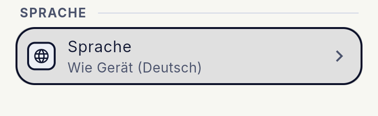
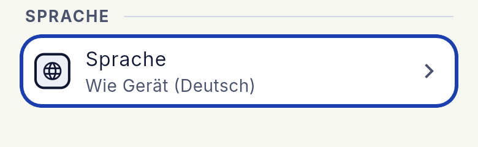
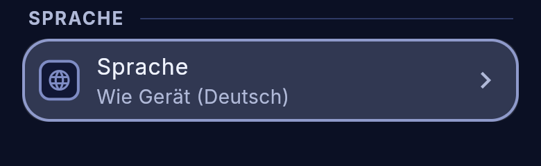
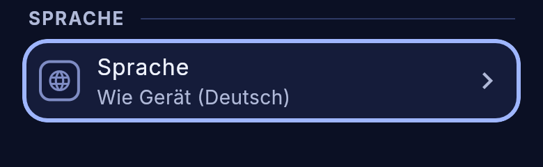
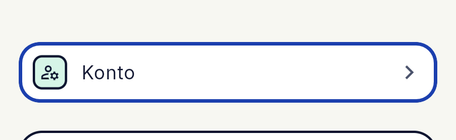
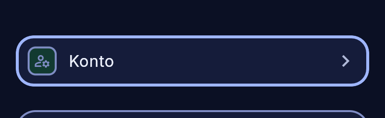
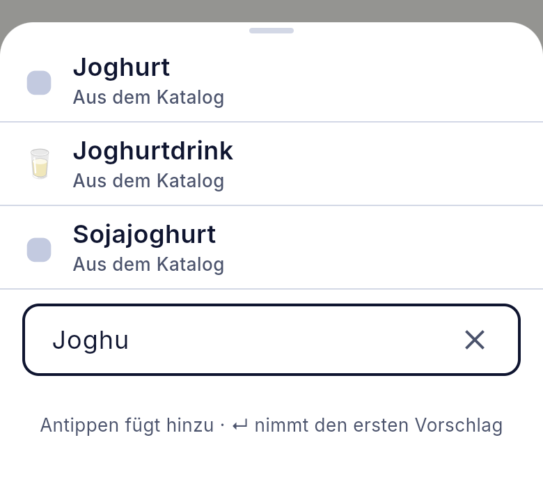
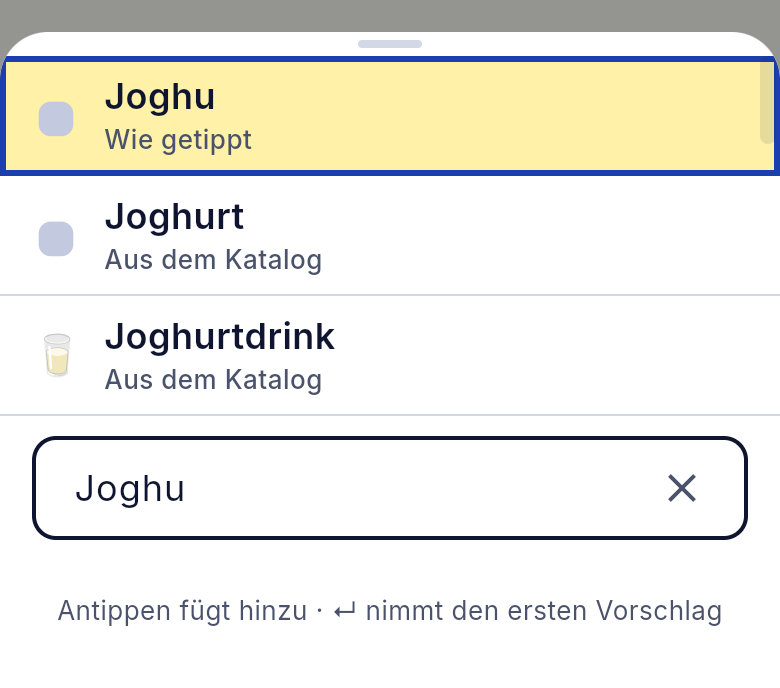
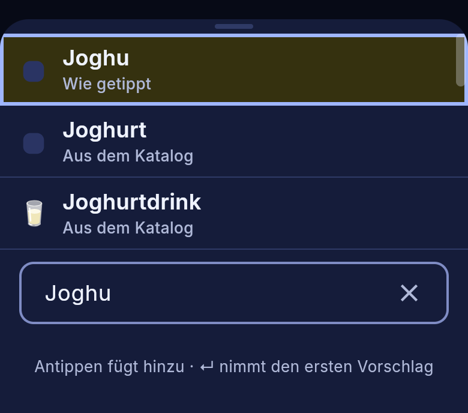

# Job 488: the FH1 focus ring on list tiles, and Tab only onto what is drawn (2026-11-27, Europe/Berlin)

Follow-up to job 487 (PR #784). This job ships as a fix: no flag, no ARB, legal or backend change.

## What users see

- Rows built on Material list tiles show keyboard focus as the FH1 ring instead of a 12 % grey fill,
  which failed WCAG 2.4.13. The ring is a cobalt band, 3 px wide, inside the row: nothing is drawn past
  the row, and nothing moves. In a rounded group card (Mehr, Einstellungen) the band follows the card's
  corners. Covered: Mehr, Einstellungen (also „Sprache“), Konto, the household pages and the household
  switcher, the voice default pages, Zugänge, Premium's manage row, the guides index, the report picker,
  the chain picker, the reminders, the switch, check box and radio rows (`HexSwitchTile`,
  `HexCheckboxListTile`, `HexRadioTile`), the currency dialog's radio list, the account deletion
  dialog's check box row, and the header of „Zuletzt verwendet“.
- When it shows is the same rule as the InkWell rows: keyboard focus only, not after a tap. Only one
  ring shows at a time. A row with a control inside (a menu button) shows no ring while that control has
  focus. The switch, check box and radio rows keep their focus on the row. Their faces get no ring, so
  a focused „on“ switch never goes solid navy.
- The add sheet: Tab after the last suggestion row now goes to the add field. Before, it stopped on the
  add bar around the field first, which draws nothing. Tab from the clear key to a first row scrolled
  out above the three-row window now scrolls that row into view. Before, it focused the row out of sight.
  The same applies anywhere a Tab lands on a control above the view, for example after wrapping from a
  scrolled page's last control to its first.
- The add field itself is unchanged: caret only, no ring (Peter, 27 Nov 2026).

Screenshots (left: main before this job, the 487 review evidence; right: this branch; release web
build, 390×844, keyboard Tab):

| | Before | After |
| --- | --- | --- |
| „Sprache“, light |  |  |
| „Sprache“, dark |  |  |
| Mehr › „Konto“, light / dark | |   |
| Add sheet after the last row, light | focus on the undrawn add bar:  | |
| Add sheet, Tab from the clear key to the first row (scrolled into view), light / dark | |   |

## Where

- `app/lib/design/focus_ring.dart`:
  - `FocusRingTile(child: <tile>)` sets `ThemeData.focusColor` transparent below it, as
    `FocusRingChip` does, and not app-wide. It draws the ring with `paintFocusRing`, the same geometry
    and colour as #784, while the tile's own node (the first focus node under it) has primary focus
    in keyboard mode.
  - The ring is the focused tile's box, intersected with the nearest rounded clip above it. For an
    `ExpansionTile` that box is only the header.
  - `revealFocus` is a `requestFocusCallback` that scrolls the node into view at whichever edge it is
    past.
- 37 tiles wrapped in 21 files: the codemod wrapped every tile with `onTap`, `onLongPress` or
  `onChanged`, plus the Material composite tiles. One tile was unwrapped again because its `onTap`
  belongs to a link inside it. Keys moved up to the wrapper, so siblings still reconcile by key (the
  switcher's drag-ordered lists).
- `app/lib/list/list_screen.dart`: the add bar's `_barFocus` is `skipTraversal`. It still parks focus
  on a close and handles Enter and Escape. The screen's `OrderedTraversalPolicy` uses `revealFocus`.
- `app/lib/shell/app.dart`: a `FocusTraversalGroup` with `revealFocus` around the navigator.
- Lint `list-tile-focus-ring` (`ast-grep/rules/`, with a test and a snapshot, and a row in the AGENTS.md
  table). It flags a focusable tile that is not the direct `child:` of `FocusRingTile`. On main it
  finds 36 of the 37 tiles. The one it misses is in `shopping_list_view.dart`, which ast-grep's Dart
  grammar cannot parse (a body-less primary constructor). The rule's header says so.
- The web journey `theme-focus.mjs` no longer has `knownFill`. A stop on a control that is not drawn now
  fails, the journey also walks Mehr, and the caret rule is stricter. Also updated: the feature file
  `theme.md`, FEATURES-FOR-WRITERS „Keyboard focus“, DESIGN.md and DECISIONS.

## How it was verified

- `test/design/focus_ring_test.dart` gained 15 tile cases, each run in hex and soft, light and dark:
  a list tile; the switch, check box and radio tiles off and on; the Material check box and radio
  tiles; an open `ExpansionTile`; and a tile in an `HlGroup`. Each case checks that focus brings a
  cobalt band of at least 3 px, that nothing changes past the tile, that nothing moves, that there is
  no fill over the face, and that a touch focus shows no ring.
  - Plus: a tile shows no ring while its menu button has focus, compared with a bare tile.
  - Plus: in a rounded group the ring is one connected band.
  - Mutants that fail these tests: no parent check, a ring around the whole wrapper, the grey fill
    left in, no keyboard gate, no ListTile check, no rounded clip.
- `test/design/hex_tiles_focus_test.dart` (unchanged) still passes: Tab reaches the hex tiles, never the
  controls inside them.
- `test/list/add_sheet_compact_test.dart`, „Tab stops only on what is drawn“: two Tab rounds over five
  rows. Every stop must be on screen and inside the rows' window, and the order must be the clear key,
  each row, then the field. It fails on main with an extra stop after the last row, and with
  Flutter's own focus request with a row clipped above the window.
- `test/design/reveal_focus_test.dart`: Tab from the last control of a scrolled page to the first
  scrolls up to it (and fails with Flutter's own request, the control case), and Tab down still
  scrolls.
- Goldens `focus-rings-{hex,soft}-{light,dark}` now hold the tile cases.
- `flutter analyze` is clean. Full `flutter test` (TZ=UTC, Flutter 3.50.0): 5202 passed, 134 skipped, 0 failed. `scripts/lint.sh`
  passes.
- Web, release build of this branch, `theme-focus.mjs` light and dark: PASS. The largest area reaches
  0.4 px past its control. Every stop shows the focus colour except the add field's caret. No stop
  lands off screen. On main, the journey's add-sheet walk focused the undrawn bar, and „Sprache“ showed
  only the grey fill.

## Not done

- iOS and Android were not driven (no simulators on this runner). The painters and the traversal are
  the same code as on web, and the widget tests cover them.
- The own-store field's fixed 48 px height (FH-Q5) is still its own job.
